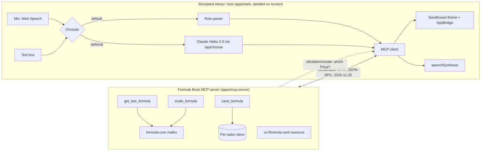

# Formula Book

Formula Book lets hair colourists say a client's colour formula at the bowl and get it back, scaled, next visit.

It is a self-hosted MCP server (Streamable HTTP, MCP spec 2025-11-25) with three tools and an MCP Apps formula card. The demo drives it from a **simulated Alexa+ client** in this repo, labelled on every screen. It has not been tested on a real Alexa+ device.

## Prior art, first

| Prior art | What it does | What Formula Book adds |
|---|---|---|
| Kenra Color skill for Alexa (2019) | Brand questions by voice: colour conversions, mixing instructions, processing times for the top 25 shades | Per-client memory, scaling to today's bowl, refusing an unknown client, a card on screen devices |
| Daviana ColorLab | Weighs the bowl on a Bluetooth scale, suggests a formula from a photo, reloads a client's last formula, confirms rather than guesses | Voice capture and spoken scaling at the bowl, on any scale, no extra hardware |
| Salon software (Zenoti, Phorest, Goldie, SureTint) | Stores formulas per client | Capture at the bowl by voice. They could add a microphone button; our answer is speed, one job, and an MCP surface any assistant can call |

Kenra's skill answers brand questions: conversions, ratios, times. Salon software and Daviana already keep each client's formula, and Daviana weighs the bowl with its own scale. Formula Book does it by voice at the bowl: say the grams, ask for one and a half times, hear it back. Any scale, no extra hardware.

Related work: `alexa-plus-sim`, an Echo-Show-style simulator with a Bedrock tool loop, elicitation and MCP Apps. None of its code is used here. Our simulator is small and exists because the rules need the simulation's source in the repo.

## What is real and what is simulated

| Part | Status |
|---|---|
| MCP server, Streamable HTTP, spec 2025-11-25; also accepts 2025-03-26 | Real |
| Three tools: `get_last_formula`, `scale_formula`, `save_formula`; the maths in `packages/formula-core` | Real |
| Two clients with one name: the server asks through MCP elicitation; on 2025-03-26, or a client without the `elicitation` capability, it returns `needs_choice` and the host asks | Real |
| MCP Apps card: `ui://formula-card/<hash>.html`, `text/html;profile=mcp-app`, linked by `_meta.ui.resourceUri`, rendered in a sandboxed iframe through the ext-apps `AppBridge` | Real, in our own host |
| `hostContext` device values (`echo-show-8`, `mobile`, `voice`) | **Our guess.** The official list is partner-only. The card falls back to `maxWidth` with a console warning when the class is unknown |
| Alexa+ itself | **Simulated.** A web page acting as the host: it lists tools, picks one, calls it over MCP and shows the card |
| Choosing the tool | Two choosers, and the badge always names the one that ran. Default: a rule parser (`apps/web/lib/rule-parser.ts`), no model call. Optional: Claude Haiku 5.5 picks one tool and its arguments from the server's own `tools/list`, as a host's model would (`apps/web/lib/chooser.ts`, called server-side from `app/api/choose`). It appears only when the web server has `ANTHROPIC_API_KEY` |
| Voice in | Chrome's Web Speech API. Chrome may send the audio to its vendor's speech service. Accuracy on shade codes is not measured; the text box always works |
| Voice out | The browser's `speechSynthesis` reading the server's sentence. Not Alexa's voice |
| Free plan of 50 formulas | Real: the server refuses the 51st save |
| Price | "Hypothesis, payments not live". Nobody is charged |
| Waitlist | A local JSON file ("Local demo store") in `DATA_DIR`. No public signup count is claimed |
| Demo data | Seeded, labelled "Demo data" in the app. Lena, Priya Shah, Priya Kapoor and Booth 12 are not real people |

## How it fits together



One turn: the utterance goes to a chooser, which picks a tool from the server's own `tools/list`. The host sends `tools/call` with the salon's bearer token. The server resolves the client (asking through elicitation if two match), does the maths, checks the plan cap and returns `structuredContent`, a speakable sentence and `_meta.ui.resourceUri`. The host renders the card it prefetched, or on the speaker frame speaks the sentence. Every JSON-RPC message appears in the traffic panel.

## Where to look, by judging criterion

| Criterion | Evidence in this repo |
|---|---|
| Tech implementation | MCP server on spec 2025-11-25 over Streamable HTTP with per-session state (`apps/mcp-server/src/app.ts`); elicitation on the request's own stream with a `needs_choice` fallback for 2025-03-26 (`choose.ts`); MCP Apps card with a content-hashed URI and empty CSP (`src/card.ts`, `card/`); host bridge with `hostContext` per device (`apps/web/components/CardFrame.tsx`); 143 unit tests and a ten-step Playwright golden path run ten times in a row |
| Design | One golden path for one user at the bowl; loading, empty, refusal and error states; three device frames from one result; every refusal is plain words with a next step, no codes |
| Potential impact | A named user (independent colourists, about 48% of 575,200 US hairdressers are self-employed); comparables that already charge for formula records (`docs/market-evidence.md`); a price hypothesis enforced by the server at 50 formulas |
| Quality of the idea | Voice capture and spoken scaling at the bowl, on any scale; the same server serves a screen card, a phone card and a speaker sentence; the server asks rather than guesses |
| Product feedback | `docs/product-feedback.md` (each tool used) and `docs/friction-log.md` (four entries with steps, expected, actual, severity, fix) |

## Run it

Node 22 or later, Chrome.

```bash
npm install
npm run dev:all
```

Open http://localhost:3000/sim for the simulated Alexa+ demo, or http://localhost:3000/site/index.html for the product site (static HTML, CSS and GSAP in `apps/web/public/site`). Try "Lena's last formula", then "Make it one and a half times", then "Colour Marta: 30 grams 6N and 20 grams 7.1, 20 volume, one to one and a half".

The MCP endpoint is `http://127.0.0.1:8787/mcp`. Two public demo tokens guard demo data only: `demo-salon-token` and `booth12-token` (send `Authorization: Bearer <token>`). Set `SALON_TOKENS` for your own.

| Variable | Default | Meaning |
|---|---|---|
| `MCP_PORT` | 8787 | Server port |
| `MCP_PATH` | `/mcp` | Endpoint path |
| `DATA_DIR` | `.data` | Where salons and the waitlist are stored |
| `SALON_TOKENS` | the two demo tokens | `token=salon` or `token=salon@<ISO expiry>`, comma separated |
| `FREE_FORMULA_CAP` | 50 | Formulas per salon on the free plan |
| `DEMO_ADMIN` | off | `1` enables `POST /admin/reset-demo` |
| `E2E` | off | `1` enables the test-only tool delay |
| `ANTHROPIC_API_KEY` | unset | Web app only. Enables the Claude chooser. Read on the server, never sent to the browser. About 700 input tokens per choice; 30 calls a minute at most |
| `CHOOSER` | on when a key is set | `off` hides the Claude chooser even with a key |

## Tests

```bash
npm test
```

```bash
npm run typecheck
```

```bash
npm run e2e
```

```bash
npm run e2e:x10
```

Unit and server tests run with Vitest (about 93% of lines). The Playwright golden path runs ten steps in Chrome against the real server, with every card assertion made inside the MCP Apps iframe, and `e2e:x10` runs it ten times in a row.

## Layout

- `packages/formula-core`: formula maths, client-name matching, speech normalising, the spoken sentence.
- `apps/mcp-server`: the MCP server, its tools, the card (`card/`), store, plan and waitlist routes.
- `apps/web`: the simulated Alexa+ host at `/sim`.
- `e2e`: Playwright tests. `seed`: demo data. `docs`: friction log, product feedback, validation questions.
- `video`: the script that recorded the demo video. `record.mjs` drives real Chrome through the golden path against a running server and captures frames with Chrome's screencast; `mux.mjs` lays the narration over them with ffmpeg. The narration is synthesised speech (edge-tts), and the footage is the product running, not a mock-up.

## Open source contribution

During the hackathon: [modelcontextprotocol/ext-apps#824](https://github.com/modelcontextprotocol/ext-apps/pull/824), a README note saying which `ext-apps` line to use with the v1 MCP SDK (1.x peers on `@modelcontextprotocol/sdk`, 2.x on the split v2 packages). This project hit that question while choosing versions.

## Business

Others already sell formula records: SalonScale says over 8,000 salons use it to weigh and save formulas, Vish and Daviana charge salons monthly for per-client formula history, and App Store apps such as Charm and Gloss sell formula saving to independent stylists. That shows the job is paid for; it does not show demand for doing it by voice. Sources and limits are in `docs/market-evidence.md`.

Pricing hypothesis: free for the first 50 formulas, then a paid plan per colourist. The price has not been tested with anyone. No colourist conversations have happened yet; the three questions we would ask are in `docs/validation.md`. The builder has no salon contacts.

## Built with

TypeScript, `@modelcontextprotocol/sdk` 1.32.1, `@modelcontextprotocol/ext-apps` 1.7.5, Express 5, Next.js 16, React 19, Tailwind 4, Vitest, Playwright. AI tools: Claude Code wrote most of the code under the builder's direction; an Anthropic API pipeline did the research and spec. See `docs/product-feedback.md` and `docs/friction-log.md`.

## Licence

MIT. See `LICENSE`.
